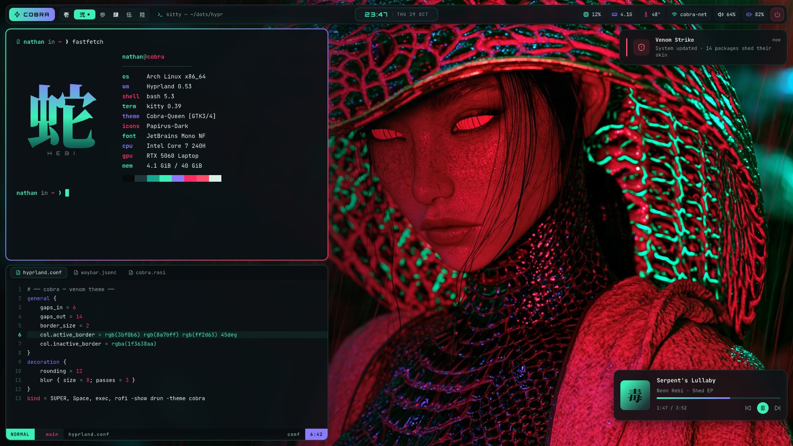
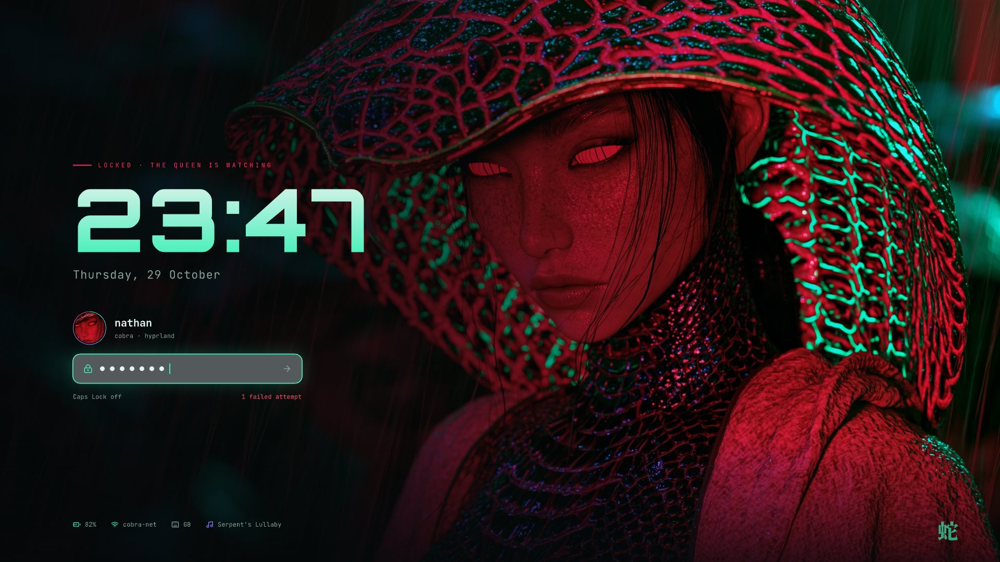
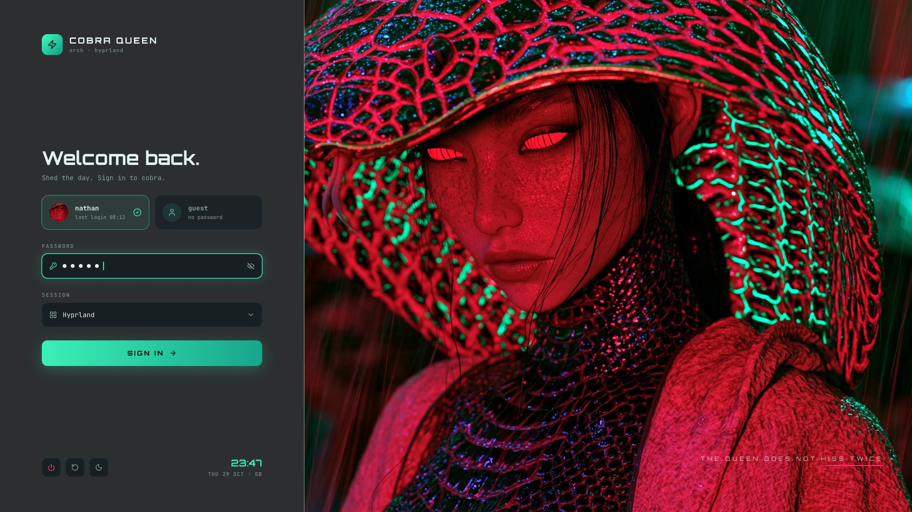

# 蛇 Cobra Queen

A Hyprland setup for Arch Linux. Mint, violet and crimson on near-black, built around a cobra-queen wallpaper.



| Lock screen (hyprlock) | Login (SDDM) |
|---|---|
|  |  |

## What's inside

| | |
|---|---|
| **WM** | Hyprland 0.57+ (Lua config) with a rotating mint → violet → crimson border and "strike" animations |
| **Bar** | Waybar, floating, with kanji workspaces 壱 弐 参 肆 伍 陸 |
| **Launcher** | Rofi, plus a power menu |
| **Terminal** | Kitty with a 16-colour Cobra palette, and fastfetch with an image logo |
| **Notifications** | Mako |
| **Visualizer** | cava, mint → violet → crimson gradient, floating on `Super + A` |
| **Lock / idle** | hyprlock + hypridle (dim 4m · lock 5m · screen off 6m · suspend 30m) |
| **Login** | Custom SDDM theme (Qt6) |
| **Wallpaper** | hyprpaper |
| **Browser** | Google Chrome (native Wayland) |

## Palette

| Name | Hex | Use |
|---|---|---|
| base | `#07090B` | background |
| venom | `#3BF0B6` | primary accent |
| sheen | `#8A7BFF` | highlight |
| crimson | `#FF2D63` | secondary accent |
| fang | `#FF4D6D` | urgent / error |
| text | `#E6F2EE` | foreground |
| muted | `#86A09A` | dim text |

## Install

Tuned for an **Alienware 15 (Intel Core 7 240H + RTX 5060 Laptop)**. It installs the NVIDIA
open driver, PipeWire with SOF firmware, and sets up the hybrid GPU.

```sh
git clone https://github.com/wattsnathan01-boop/cobra-queen-dots.git ~/cobra-queen-dots
cd ~/cobra-queen-dots
bash install.sh
```

New Arch install? See [ARCH-INSTALL.md](ARCH-INSTALL.md).

## Keybinds

| Keys | Action |
|---|---|
| `Super + Return` | Terminal |
| `Super + Space` | Launcher |
| `Super + B` | Chrome |
| `Super + E` | Files |
| `Super + Q` | Close window |
| `Super + F` | Fullscreen |
| `Super + V` | Toggle floating |
| `Super + L` | Lock |
| `Super + Esc` | Power menu |
| `Super + A` | Audio visualizer |
| `Super + Shift + V` | Clipboard history |
| `Super + 1–6` | Switch workspace |
| `Super + Shift + 1–6` | Move window to workspace |
| `Print` / `Shift + Print` | Screenshot area / full screen |

Run games on the RTX 5060 with `prime-run <app>` (Steam launch options: `prime-run %command%`).
